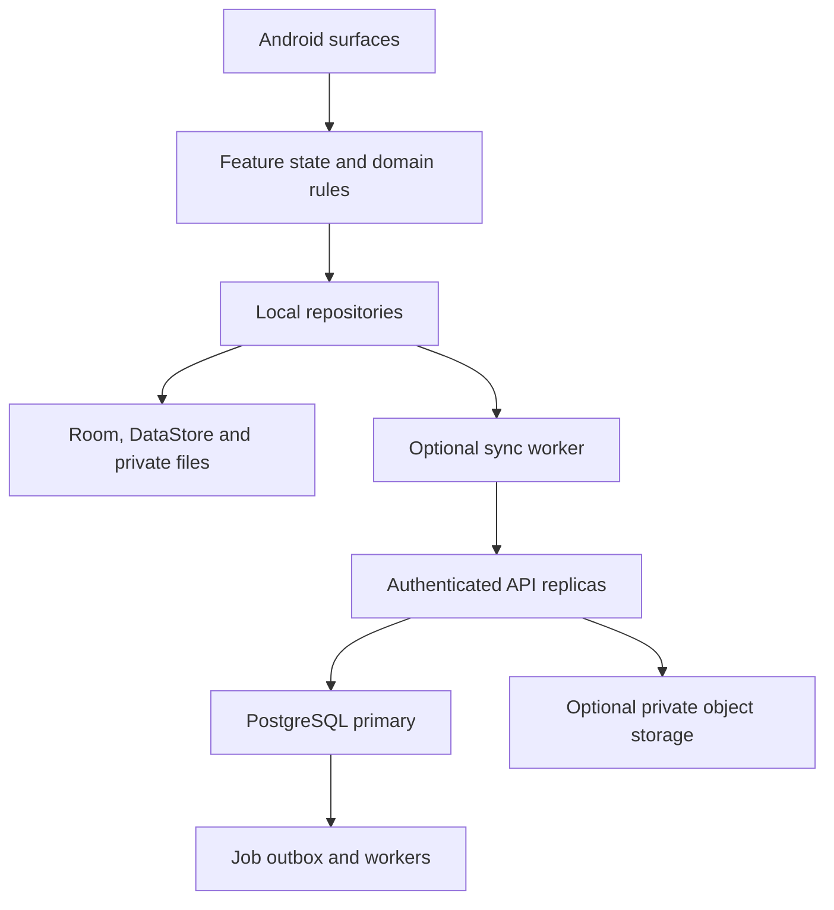

# Veil Reader — production system architecture

Status: written architecture proposal; cloud services and new database migrations are not implemented. The existing reader-foundation plan remains independently approved. New cloud work requires its own reviewed specification, implementation plan and verification.

## 1. Product and evidence boundary

Build a premium Android EPUB/PDF reader with optional progression and optional account-based synchronization. Reading, import, search within an available publication, annotation and local backup work without an account or network. The Grayfog identity supports a quiet parchment reading surface, an accessible searchable archive and an optional atmospheric world.

Observed source: `hminthakil-eng/Veil-Reader`, main product base `811f0d7d521fc11f110638a100c315f698d52fd5`; durable test checkpoint `30998d1945dda6a9afd639f71fdf42436f36e52a` in draft PR #556. Source modules are currently `:app` and `:benchmark`, with Kotlin/Compose, Readium 3.4.0, Room database version 3, DataStore, Android API 26 minimum/API 37 target. There is no deployed sync backend in this inspected source.

At checkpoint #556, Android CI, storage instrumentation, emulator performance, dependency baseline and dependency review workflows report success. The quality-dashboard workflow was cancelled. These receipts belong to that checkpoint, not unpublished source changes, physical-device quality or a million-user load test. Earlier source extractions had local scoped test receipts, but were not published before a sandbox reset; recover and verify them before calling them delivered.

The request for a complete scalable product sets the quality bar. It does not establish production readiness. Release requires the gates below, actual signed artifacts and independent device evidence.

## 2. Architectural decision

Recommended: a modular native client plus an optional modular-monolith sync service. Keep established reader/storage components. Start with clear package ownership, then split Gradle modules only where independent build ownership or dependency enforcement warrants it.

| Alternative | Decision and trade-off |
|---|---|
| Native offline client + stateless API replicas + PostgreSQL | Recommended; scales reading across devices naturally and keeps online costs bounded to optional services |
| Rewrite everything as a web app | Does not preserve existing Android publication integration, local storage, gestures or device QA |
| Immediate microservices/Kubernetes/multi-region writes | Extra operational and consistency complexity before measured need; defer |

The renderer is an adapter owned by the client reader feature, not a remote service. Never route page gestures or frame rendering through the backend. Observe local storage for UI state; remote reconciliation updates local storage through repositories.

## 3. Client ownership and UI architecture

| Unit | Owns | Must not own |
|---|---|---|
| Publication adapter | Readium publication lifecycle, layout, locator observation and EPUB/PDF capability | A second independent pagination model |
| Reader session | Open generation, writer lease, accepted navigation sequence and engaged-reading session | GPU texture lifecycle or account networking |
| Input arbitration | Existing selection, accessibility, PDF zoom, Paper/Slide/Paged/Scroll ownership | Database writes from preview frames |
| Reader surfaces | Chrome, search, contents, notebook, appearance and listening presentation | Persisting progress directly or inventing a successful save |
| Library/archive | Import, duplicate handling, metadata, collections and retrieval | Rendering all covers or publications eagerly |
| Persistence | Room transactions, migrations, DataStore preferences, explicit backup | Network availability as a prerequisite to opening a book |
| Listening | One playback controller, provider readiness, interruptions and stable voice choice | Claiming a model is ready before it can synthesize |
| Optional world | Original progression content and committed reading summaries | Reading gestures, private book text, competitive rewards trusted from client clocks |
| Sync adapter | Account session, retryable outbox and reconciliation | Direct Compose state mutation or opening imported books on a server |

UI state flows from repositories to ViewModels to lifecycle-aware Compose collectors. User intents return to the owning feature; confirmed persistence produces success state. Keep native navigator/view resources lifecycle-bound. Cancellation, superseded callbacks and stale layout epochs must be rejected by existing ownership fences.

Navigation has three primary destinations: Read, Library and optional World. Archive/notes/search remain explicit accessible destinations. Settings use clear localized names. Reader center-tap reveals compact chrome; Back dismisses the active surface or cancels a preview before closing. Appearance previews show the actual publication when integrated. Global defaults and future per-book overrides are distinct concepts; the current global DataStore implementation must not be relabeled per-book persistence.

Cover empty/importing/corrupt/offline/permission-lost states, save failure with retry, missing voice/model, unsupported page mode and stale sync conflict. Render actual progress only. Support Persian RTL, 200% font, TalkBack, reduced motion, small phones, tablets and foldables. Fog/stars/3D stop rendering while reading or backgrounded; an ordinary accessible library list remains available.

## 4. File structure and dependency boundaries

Current root: `app/`, `benchmark/`, `app/schemas/`, `tools/`, `quality/`, `performance/`, `qa/fixtures/`, `.github/workflows/` and `docs/`. The following paths are the target ownership map; future paths are explicitly proposals, not existing modules.

| Path | State | Responsibility |
|---|---|---|
| `app/src/main/java/com/veilreader/app/data/db/` | Existing | Entities, DAOs, migrations and exported Room schema |
| `app/src/main/java/com/veilreader/app/data/` | Existing | Publication, library, backup and durable session repositories |
| `app/src/main/java/com/veilreader/app/ui/reader/` | Existing | Session, navigation, input, material rendering and TTS boundaries |
| `app/src/main/java/com/veilreader/app/ui/screens/ReaderScreen.kt` | Existing | Current lifecycle/navigation orchestration; progressively reduce coupling |
| `.../ui/screens/ReaderRendererPreferences.kt` | Approved foundation extraction | Pure mapping from effective settings to renderer preferences |
| `.../ui/screens/ReaderChromeComponents.kt` | Approved foundation extraction | Reusable reader controls and icons |
| `.../ui/screens/ReaderAppearanceComponents.kt` | Approved foundation extraction | Appearance sheet and mode selectors; further subcomponents only if needed |
| `.../data/sync/` | Proposed later | Outbox DAO, network models, reconciler and scheduled worker |
| `.../domain/sync/` | Proposed later | Versioned mutation/conflict contracts without Android or HTTP dependencies |
| `server/src/main/kotlin/.../identity/` | Proposed later | OIDC identity mapping and device sessions |
| `server/src/main/kotlin/.../sync/` | Proposed later | Mutation admission, deduplication, journal and snapshot endpoints |
| `server/src/main/kotlin/.../library/` | Proposed later | Account-scoped book metadata and annotation services |
| `server/src/main/kotlin/.../jobs/` | Proposed later | Account export/deletion and optional object cleanup workers |
| `server/src/main/resources/db/migration/` | Proposed later | Reviewed PostgreSQL expand/contract migrations |
| `server/src/test/` | Proposed later | Real database, isolation, concurrency and protocol tests |
| `contracts/openapi/` | Proposed later | Reviewed API schema and compatibility fixtures |
| `infra/`, `load-tests/`, `runbooks/` | Proposed later | Reproducible deployment, capacity experiments and incident recovery |

Server recommendation is Kotlin/Ktor to reuse the team's language and selected pure domain contracts; no version is pinned or dependency installed by this document. Keep transport models separate from Room entities and server rows. Only deliberately shared serialization/validation contracts cross the boundary, never Android views or database implementation types.

## 5. Database schema — existing local truth

The complete existing tables, foreign keys and indexes are derived from the committed Room export in [LOCAL_SCHEMA_V3.md](LOCAL_SCHEMA_V3.md). That document contains all 15 current tables and 40 CREATE TABLE/INDEX statements. Its SQL was parsed in an isolated in-memory SQLite database with foreign keys enabled; syntax/integrity checking is not a substitute for Android Room migration tests.

| Existing tables | Purpose |
|---|---|
| `books` | Catalog identity, current locator/progress, source URI, metadata and regenerable cover reference |
| `highlights`, `bookmarks` | Book-scoped annotations and locations; foreign keys cascade with book deletion |
| `collections`, `book_collection` | Unique normalized collection names and many-to-many shelves |
| `reading_sessions` | Engaged reading history; deleting a book preserves history with nullable book reference |
| `reading_cycles`, `passage_visits`, `reading_milestones` | Completion history, revisits and uniquely keyed milestones |
| Six `manga_*` tables | Chapters, source mappings, progress and offline cache facts attached to canonical books |

Keep source URIs and private file paths local. Do not rewrite this database to PostgreSQL on the phone. Local preferences remain in DataStore. Future synchronized mutations require a separately designed local Room migration for an outbox and sync metadata; do not bolt nontransactional network writes onto existing UI callbacks.

## 6. Proposed cloud schema — not applied

All business records use account-scoped keys. Child foreign keys include `account_id`, preventing a valid child ID from referencing a different account's parent. Use typed columns for queryable state; JSONB is bounded and versioned for locator/transport structures, not a replacement for constraints.

| Table | Key / important columns | Constraints and indexes |
|---|---|---|
| `accounts` | `id uuid PK`, `state`, `sync_revision bigint`, timestamps | Revision >=0; ACTIVE/DELETING/DELETED state |
| `identities` | `account_id`, `issuer`, `subject` | Unique `(issuer, subject)`; validated issuer/subject mapping, no email-based account linking |
| `devices` | PK `(account_id, id)`, `epoch`, `last_applied_seq`, status, last seen | Composite account FK; revoked epoch cannot submit work |
| `user_books` | PK `(account_id, id)`, content SHA-256, title, author metadata, format, revision, deleted_at | Partial unique active `(account_id, content_sha256)`; index account + update revision; never expose cross-account hash existence |
| `annotations` | PK `(account_id, id)`, book_id, locator, quote, note, color, revision, deleted_at | Composite book FK; bounded text/JSON; index `(account_id, book_id)` |
| `bookmarks` | PK `(account_id, id)`, book_id, locator, label, revision, deleted_at | Composite book FK; index account + book |
| `book_progress` | PK `(account_id, book_id)`, canonical locator, revision, last_device_id | Edition-safe locators; compare-and-set canonical resume state |
| `device_book_progress` | PK `(account_id, device_id, book_id)`, locator, device_seq, received_at | Composite device/book FKs; retain device-specific progress during conflict |
| `collections`, `book_collections` | Account-scoped collection IDs and book/collection composite join key | Unique active normalized collection name; composite parent FKs |
| `sync_journal` | PK `(account_id, revision)`, mutation kind, entity_id, payload_schema, payload, created_at | Stable account-ordered change stream; bounded payload and retention |
| `mutation_receipts` | `(account_id, device_id, epoch, mutation_id)`, seq, body_hash, result | Unique device/epoch/seq; repeated ID with different admitted body is a conflict |
| `server_jobs` | id, account_id, kind, state, attempt, available_at, lease_until | Transactional enqueue; indexed due jobs; retry/dead-letter policy |

UUID primary keys do not by themselves enforce tenant isolation. The runtime database role is neither table owner nor superuser and has no BYPASSRLS. Force/enforce row-level policies where used, set account context transaction-locally from verified authentication, and keep migration ownership separate. Every query still scopes by authenticated account. Identity lookup before account resolution uses a narrowly scoped service path, not a client-supplied account setting. Prove isolation with pooled-connection reuse and cross-account tests against real PostgreSQL.

## 7. API and synchronization contract

| Endpoint | Contract |
|---|---|
| `POST /v1/devices` | Register a device/epoch after authentication and enrollment limits |
| `POST /v1/sync/mutations` | At most 100 mutations / 256 KiB request; versioned envelope, ordered device sequence and idempotent receipts |
| `GET /v1/sync/changes?cursor=...` | Account-bound opaque cursor; at most 500 events; no offset pagination |
| `GET /v1/sync/snapshot` | Consistent bounded snapshot with a watermark; used for first sync or expired cursor recovery |
| `POST /v1/exports`, `GET /v1/exports/{id}` | Asynchronous user export, scoped status and expiring private result |
| `DELETE /v1/account` | Reauthenticated deletion request, revocation and auditable cleanup lifecycle |
| Health/readiness endpoints | Liveness independent of dependency health; readiness reflects serving ability without exposing internals |

1. Reading commits locally first. A future sync-enabled repository writes durable data and its Room outbox entry in one transaction. UI observes local state. Network loss cannot roll back an acknowledged local save.
2. Upload only after opt-in and account enrollment. V1 sync includes book metadata, selected annotations/bookmarks and reading location. Imported book binaries, raw reading text, TTS audio/models, manga caches and game economies do not automatically enter sync. Global DataStore preferences remain local until a separate atomic bridge is designed.
3. A mutation contains device/epoch, unique mutation ID, monotonically increasing sequence, kind, entity ID, base entity revision and bounded versioned payload. Once transmitted, never replace its body under the same ID because a timed-out request may already have committed.
4. Under a short per-account database row lock, validate current device sequence, deduplicate admitted requests, apply or record a domain conflict, increment account revision if state changed, write journal/receipt and commit. Different accounts have independent locks. Do not use a bare global sequence as a committed-change cursor: allocation order can differ from transaction commit order.
5. Valid admitted conflicts are durable results and consume device sequence; a client cannot block all later operations behind an already-recorded conflict. Malformed/oversized/unsupported envelopes fail before admission without consuming sequence. The client keeps that outbox item in actionable error state; no silent drop/renumbering. Repair/re-enrollment must reconcile the server's acknowledged sequence before resuming.
6. Notes use compare-and-set revisions. On conflict, preserve both versions and require a deliberate resolution. Canonical progress also uses compare-and-set: an old offline device must not silently overwrite a newer acknowledged resume location. Store its device-specific location and offer a choice. Never resolve resume conflicts by maximum page number; rereading and backward navigation are valid.
7. Pull uses a consistent account watermark; apply events and advance local cursor in the same Room transaction. Authentication binds every cursor and entity lookup to one account. A cursor older than retained history returns snapshot-required, never a misleading empty success.
8. Target 90-day journal/tombstone retention initially, subject to cost/privacy review. Prune receipts only for revoked/expired device epochs with enforced re-enrollment and reconciliation. Active epochs retain deduplication receipts. Test deletion/reimport and long-offline recovery so tombstone pruning cannot resurrect deleted notes/books.
9. Retry transient failures with exponential backoff, jitter and server retry hints. Authentication, validation and conflict failures have distinct actions. Use constrained scheduled work; do not keep wake locks or a permanent socket merely for progress sync.

Book identity is account-local and edition-specific. Server adoption of an existing anonymous library is an explicit reconciliation, not overwriting local IDs or matching titles. A locator cannot be applied to a different content digest without a reviewed remapping path.

## 8. Security, privacy and expensive work

Native sign-in uses the system browser and authorization code + PKCE through a selected OIDC provider; do not ship a client secret in an APK or embed provider passwords in a WebView. Validate signature, issuer, audience, expiry and session revocation at the service boundary. Rotation/revocation and deletion must be integration-tested.

Treat EPUB/PDF/ZIP/model packages and remote URLs as untrusted: bound expanded sizes, counts, nesting, compression ratio and work; reject traversal/links; avoid whole-book buffering; do not allow server-side fetches of arbitrary imported URIs. A future binary-backup feature requires private object keys, quotas, short-lived scoped upload/download authorization, content validation and deletion behavior before release.

No book title, quote, note, private URI, locator payload, raw token or full request body in logs/traces/crash reports. Use request IDs, error categories and bounded non-content diagnostics. Explain sync data categories before opt-in. Encryption at rest/TLS is not a claim of end-to-end encryption; do not market E2EE without a separate key/recovery/search threat model and implementation.

Cloud TTS and AI are separate explicitly enabled products with per-user budgets, job limits and provider consent. Offline TTS remains available according to verified model/provider capability. Cache/queue failures cannot invent successful speech or lose reading progress.

## 9. Capacity model — assumptions, not measured capability

Separate downloads, monthly active users, daily active users, concurrent readers and sync request rate. A million offline readers do not require a million concurrent backend connections.

| Planning input | Assumption |
|---|---|
| Monthly active accounts | 1,000,000 |
| Daily active accounts | 100,000 |
| Accepted average sync mutations per daily account | 20/day, after local coalescing |
| Mutation volume | 2,000,000/day ≈23.15/s average |
| Pull/other request allowance | An additional 2,000,000/day |
| Combined average | ≈46.30 requests/s |
| Initial burst experiment | 20× average ≈926 requests/s; round test target to 1,000 requests/s |
| Mutation payload planning size | 2 KiB average →≈3.8 GiB/day raw payload before indexes, responses, replicas and backups |

Run realistic authenticated workloads: repeated idempotency keys, multiple devices per account, hot accounts, concurrent note edits, long-offline batches, journal expiry, account deletion, database failover and slow dependencies. Include payload and data-size distributions, not empty health checks. Simulate at least 24 hours of steady state and a separate 1,000 requests/s burst before sizing production.

First deploy a stateless modular service behind a managed load balancer with managed PostgreSQL, bounded connection pools and private storage only if required. Add API replicas from measured saturation; pooled connections have a fixed global budget. Use the primary for sync watermark reads; a lagging replica must not issue authoritative cursors. Add workers independently for exports/deletion. Add replicas, partitioning or service extraction only after query/queue/operational measurements justify them. No multi-region concurrent writes in v1.

Proposed online targets: 99.9% monthly API availability, 250 ms p95 for ordinary small authenticated sync mutations within the test region, and no duplicate admitted effects during retries. These are acceptance targets, not current service performance. Load tests must also report error rate, p99, CPU/memory, database lock/connection time, WAL/replication lag, queue age and storage growth. Cost includes idle compute, database/IOPS, backups, observability, object egress and provider jobs; do not promise a per-user price before measuring.

## 10. Production engineering and release gates

| Gate | Required evidence |
|---|---|
| Client correctness | Exact-source unit/lint/build, Room migration/backup/restore tests, process-death durability, all four reader modes and PDF ownership |
| Native quality | Actual phone 60/120 Hz motion, RTL/LTR, 200% font, TalkBack, reduced motion, memory/thermal and lifecycle recovery |
| Client performance | Existing physical startup/frame budgets; emulator guardrails remain separate and cannot prove physical quality |
| Sync correctness | Real PostgreSQL transactions/RLS, retry/lost-response dedup, ordering, CAS conflicts, expiry, deletion and device revocation |
| Operations | Structured content-free telemetry, actionable alerts, incident/deletion/export runbooks, on-call ownership and rollback rehearsal |
| Data recovery | Managed backups + point-in-time recovery; restore into an isolated environment and measure recovery. Proposed service RPO <=5 min/RTO <=1 hour must be demonstrated |
| Scale/cost | Recorded load profile/results at the target workload and a reviewed monthly cost model |
| Supply chain | Pinned/checksummed tooling, dependency/license review, SBOM, secret scanning and protected signing keys |
| Delivery | Immutable artifacts with hashes/signers; protected main; backward-compatible APIs/migrations; internal → limited beta → staged public rollout with defined rollback signals |

Keep account sync behind a reversible feature gate. A server outage leaves local reading available. Database migrations use expand/contract and support app API versions N/N-1 for a defined compatibility window; never rely on all users updating at once. Stop rollout on data loss, tenant leakage, crash/ANR regression, sync corruption or a failed restore drill.

## 11. Execution sequence

1. Finish, independently review and publish the already-approved reader-boundary extraction. Recover exact code and rerun uncompleted checks after sandbox loss; earlier successful scoped tests do not certify a newer tree.
2. Validate one premium end-to-end reading journey and the actual installed Paper build before broader UI changes.
3. Specify and implement Home/Library and true per-book settings as separate reversible slices, with native design evidence and storage migration tests where required.
4. Review a separate sync-v1 protocol/migration/identity spec based on this architecture, including all failure modes in section 7. Then write its detailed implementation plan and a vertical client→API→database→client test before adding other cloud features.
5. Implement export/deletion, recovery and operational hardening; run the capacity/cost experiments. Only after these gates does a production-readiness claim become reviewable.

## Primary references

- Android offline-first architecture: https://developer.android.com/topic/architecture/data-layer/offline-first
- Ktor REST API structure: https://ktor.io/docs/server-create-restful-apis.html
- PostgreSQL row security and role caveats: https://www.postgresql.org/docs/current/ddl-rowsecurity.html
- Native-app OAuth guidance: https://www.rfc-editor.org/rfc/rfc8252

These sources support platform patterns. They do not verify Veil's implementation, service scale, security, visual quality or release readiness.
